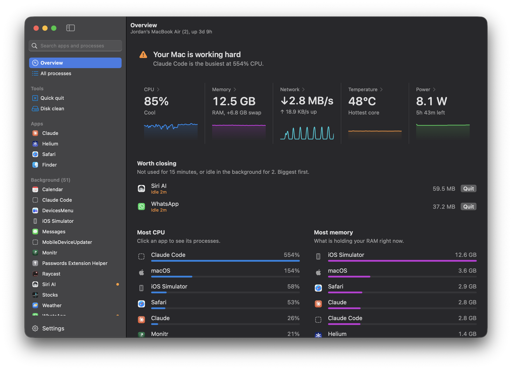
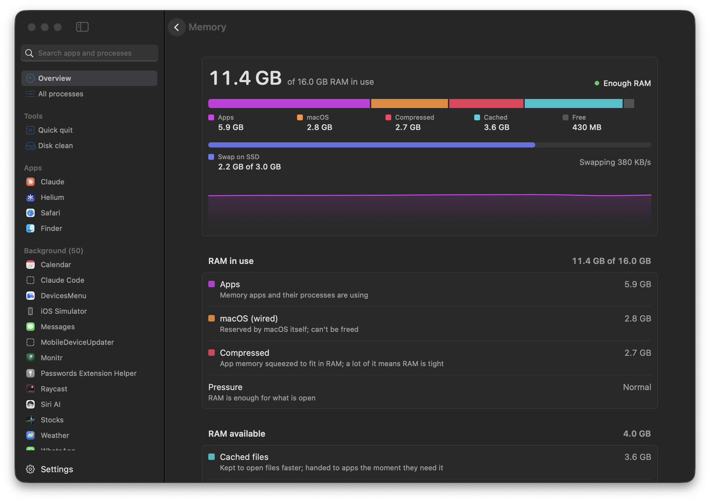
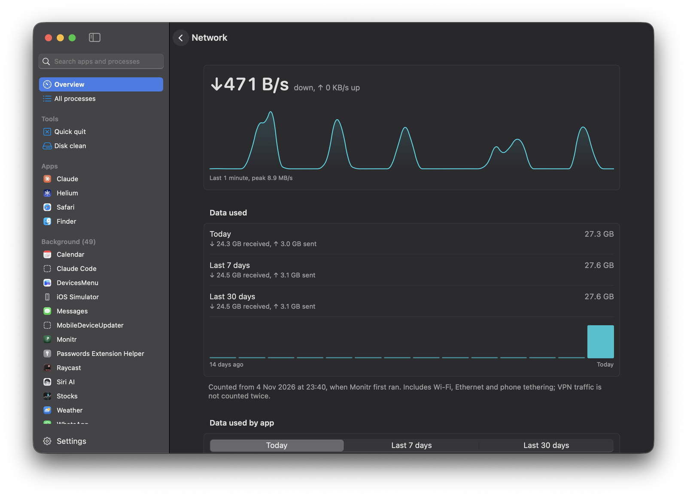
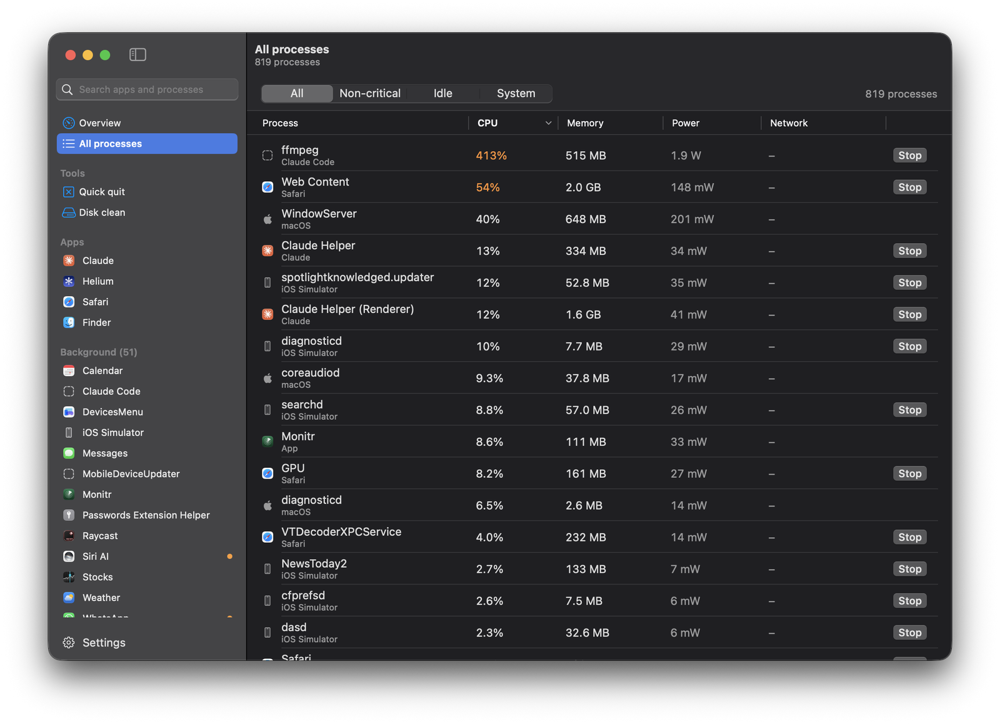
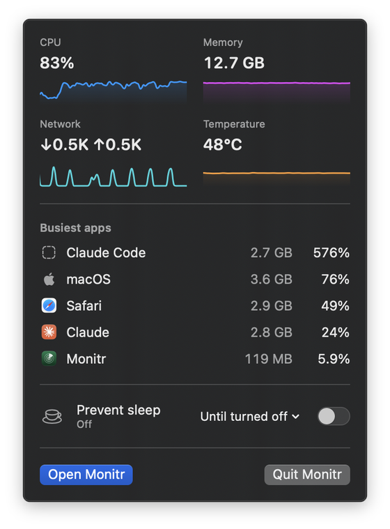
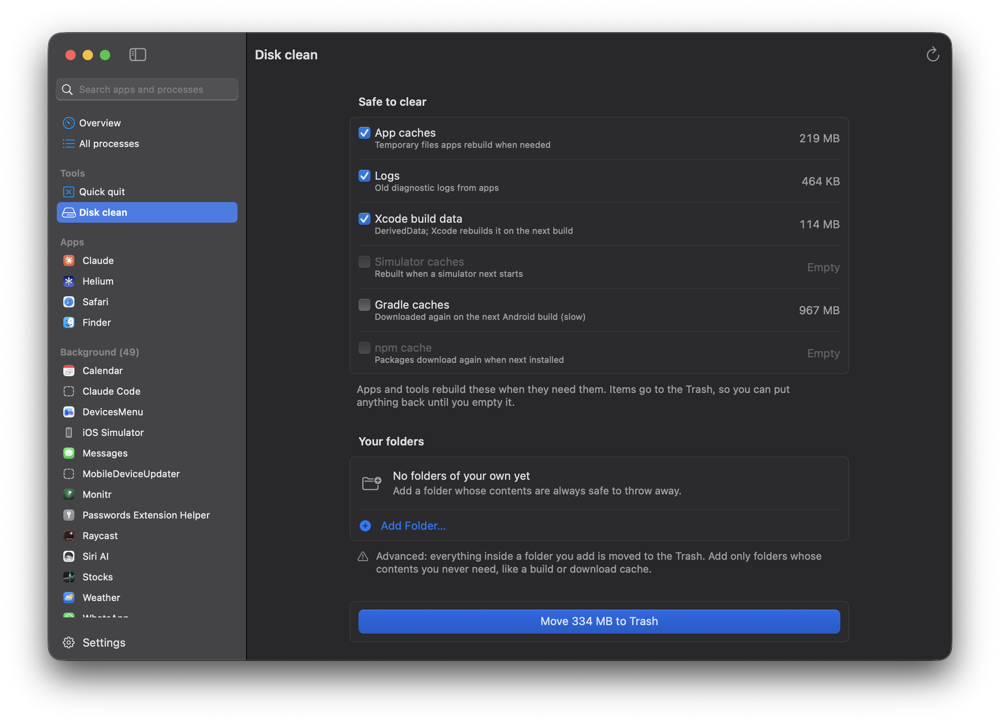
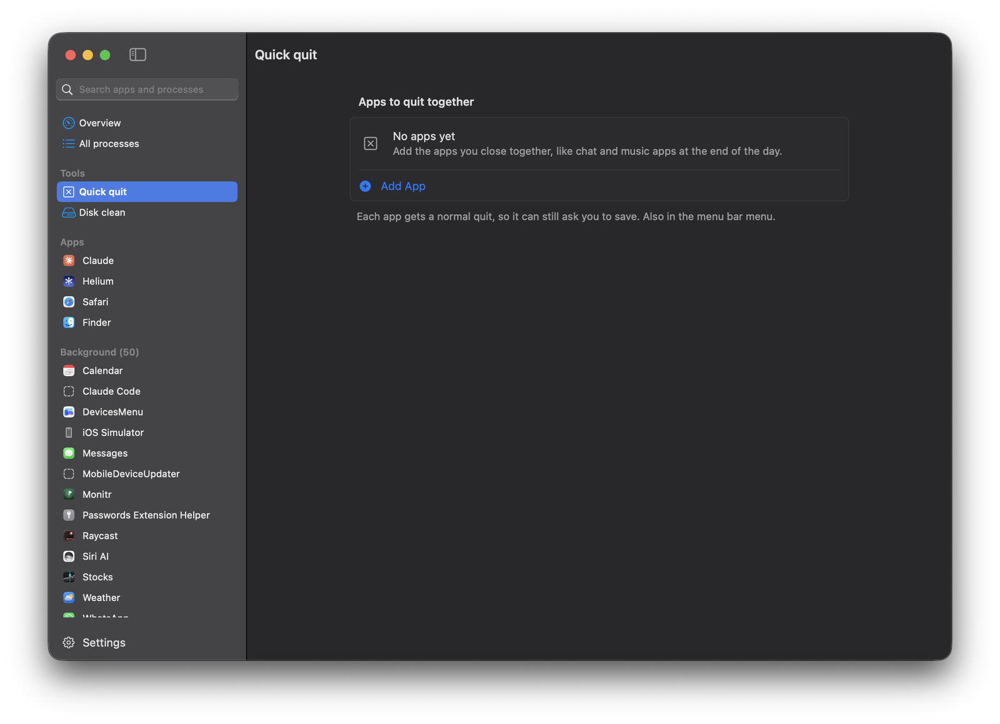
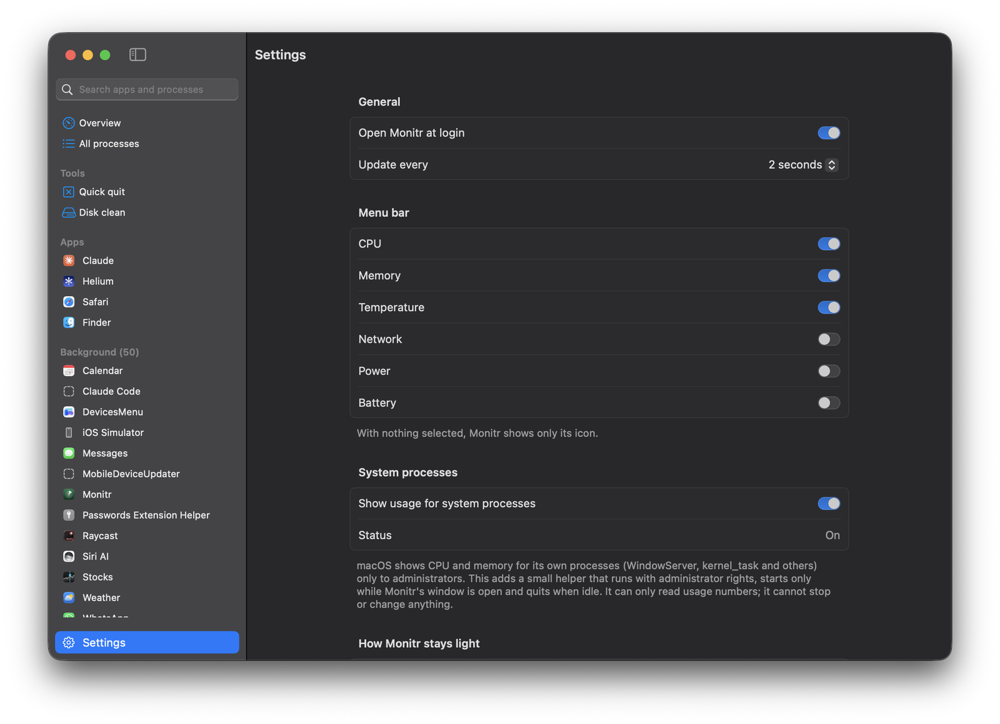

<p align="center">
  
</p>

<h1 align="center">Monitr</h1>

<p align="center">
  See what your Mac is doing, which app is behind it, and what you can close.<br>
  A small native macOS app with live stats in the menu bar.
</p>

<p align="center">
  
</p>

Built for Apple Silicon Macs on macOS 15 or later. Swift and SwiftUI, no dependencies.

## Overview

The window opens on one sentence about how your Mac is doing, most urgent first: too hot, short
on memory, low battery, working hard, or running smoothly. Below it are CPU, memory, network,
temperature and power with a live chart each, apps worth closing when there are any, and the
apps using the most CPU and memory. Click any metric for its detail page, or any app for its
processes.

## Detail pages

<table>
  <tr>
    <td width="50%"></td>
    <td width="50%"></td>
  </tr>
  <tr>
    <td><b>Memory.</b> One look shows how RAM is split (apps, macOS, compressed, cached, free) and how much spilled into swap on the SSD, with a plain "Enough RAM" or "RAM is tight". Explanations follow below.</td>
    <td><b>Network.</b> Data used today, in the last 7 and 30 days, per day for two weeks and per app, plus each connection's totals.</td>
  </tr>
</table>

- **CPU:** apps versus macOS share, load on every core (efficiency and performance, value on
  hover), load average and uptime.
- **Temperature:** heat level and every sensor, grouped into CPU cores, chip, storage and battery.
- **Power and battery:** charging status, time to full or empty, adapter, what the Mac is
  drawing, and battery health (maximum capacity, cycles, voltage, current).

Every detail page lists what is using the most of it, by app or by single process; apps expand
to show their processes. Hover a chart to read any point.

## Every process, and the app behind it

<p align="center">
  
</p>

- Each process shows its CPU, memory, power draw and network rate, and the app it belongs to:
  helpers, renderers and command-line tools are grouped under the app that launched them.
  Helpers get readable names ("Web Content", not `com.apple.WebKit.WebContent`).
- Search from the sidebar, sort any column, and filter to non-critical, idle or system
  processes. The sidebar lists the apps you opened first and background items below.
- **One-click Stop:** apps get a normal quit so they can save; other processes get SIGTERM.
  Option-click forces it. If something refuses to quit, Monitr says why and offers Force Quit.
  macOS's own processes have no Stop button.

## Menu bar



Pick any of CPU, memory, temperature, network, power and battery for the menu bar. Click it for
a panel with the key numbers, the busiest apps, Prevent sleep and Quick quit.

**Prevent sleep** keeps the Mac awake until turned off or for 30 minutes to 4 hours, optionally
with the display on. A cup shows in the menu bar while it is on. Closing a MacBook's lid still
sleeps it unless an external display is connected.

<br clear="right">

## Tools

<table>
  <tr>
    <td width="50%"></td>
    <td width="50%"></td>
  </tr>
  <tr>
    <td><b>Disk clean.</b> Measures regenerable data (app caches, logs, Xcode build data, simulator caches, and optionally Gradle and npm caches) plus folders you add, then moves what you pick to the Trash. Nothing is lost until you empty it, and personal or macOS folders can't be added.</td>
    <td><b>Quick quit.</b> A saved list of apps to quit together in one click, from the window or the menu bar panel. Each gets a normal quit, so it can still ask to save.</td>
  </tr>
</table>

## Settings

<p align="center">
  
</p>

Open at login, the update interval, which stats show in the menu bar, and an optional helper
that adds CPU and memory for macOS's own processes (see Limits).

## How it stays light

- With the window and panel closed, Monitr reads only whole-Mac counters, one pass every 2
  seconds on a low-priority queue with timer leeway so macOS can batch the wakeups. About 0.7%
  CPU and 45 MB on an M4 MacBook Air, data-usage tracking included.
- Per-process figures are measured only while the window or the menu bar panel is visible.
  The window refreshes every 2 seconds while it is the active window and every 6 seconds when
  it sits behind other apps (about 4% CPU); covered or minimised, it pauses.
- Charts and bars are Core Animation layers, so their motion runs in the system compositor
  rather than costing Monitr work on every frame.
- CPU, memory, energy, temperature and battery come from system calls in-process (`sysctl`,
  `proc_pid_rusage`, Mach host statistics, IOKit). Per-app network uses one-shot `nettop`
  snapshots (about 10 ms of CPU each): every few seconds while the window is open, once a
  minute otherwise. macOS gives full per-app network counters only to Apple's own entitled
  tools; an app reading them directly misses most traffic.
- The menu bar label is drawn once per change into a small bitmap.

## Limits

- **Processes owned by root or other users** (for example `WindowServer`, `kernel_task`): macOS
  gives their CPU and memory only to administrators. Turn on Settings > "Show usage for system
  processes" to add a small read-only helper that runs as root (approved once in System
  Settings > Login Items). Without it they show a dash; whole-Mac totals include them either way.
  The helper only reads usage counters, answers only Monitr signed by the same developer team,
  and exits when idle.
- **Temperature** is the hottest CPU die sensor, read through a private IOKit HID interface.
  macOS has no per-process temperature; per-process power is the closest measure of which
  process is heating the Mac.
- **Data usage** is counted from when Monitr first ran, and only while it is running. The
  whole-Mac total is exact; per-app totals can miss traffic from an app that quits between
  minute-long checks. Stored in `~/Library/Application Support/Monitr/usage.json` for 90 days.
- Because of those private interfaces and the need to see other apps' processes, Monitr cannot
  ship on the Mac App Store. It is built and run locally.

## Tests

```bash
swift test
```

Covers the pure logic in `Sources/MonitrCore`: Disk clean's safety rules (which folders may
never be emptied), process naming, `nettop` parsing, number formatting and chart history.

## Build and run

```bash
./scripts/build-app.sh --install
```

This builds a release `Monitr.app` with its helper, signs both with the Developer ID certificate
when it is in the keychain (ad hoc otherwise, without the helper), and copies it to
`/Applications`, signed with Apple's secure timestamp. Set `MONITR_SIGN_IDENTITY` to use
another certificate; the helper's code signing checks in
`Sources/MonitrShared/HelperProtocol.swift` name the team ID.

The app is not notarized by default. To share it with other Macs, store notarization
credentials once (`xcrun notarytool store-credentials <profile>`) and build with
`MONITR_NOTARY_PROFILE=<profile> ./scripts/build-app.sh`. Without
`--install` the app is left in `build/`.

## Licence

MIT
